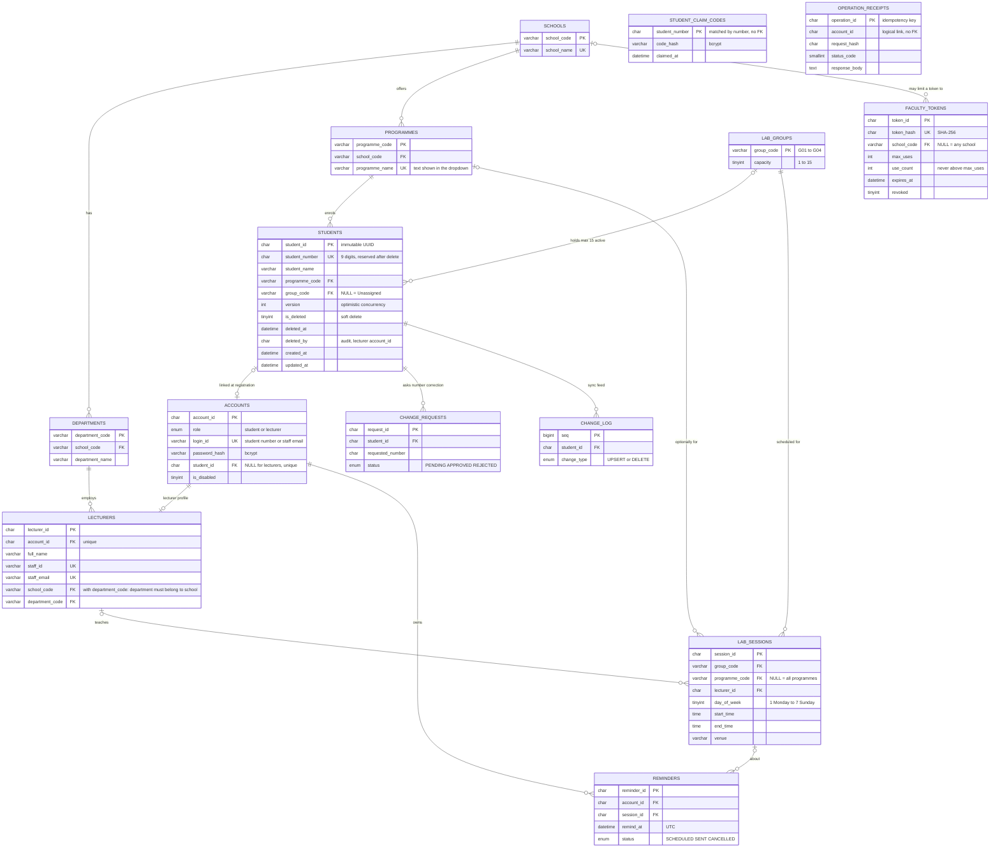

# ER diagram v3 (Activity C)

Paste the block into https://mermaid.live to export a PNG/SVG for your submission
(GitHub also renders it directly).

Rules the database enforces by itself (proved by `docs/DB_CONSTRAINT_PROOFS.txt`): 9-digit student number, unique number (also
after soft delete), valid programme and group, group capacity never above 15, a deleted student must carry a deletion marker,
a student account must point to a profile, a lecturer's department must belong to their school, a token can never be used
more times than allowed, and a session cannot end before it starts. The 15-active-students-per-group rule itself is enforced by
the server inside a transaction (Challenge 1), because it depends on a count across many rows.
